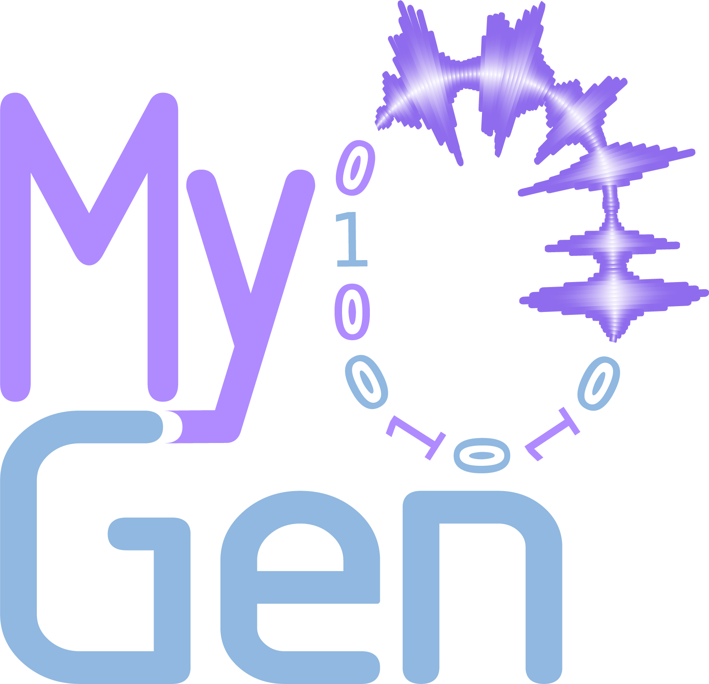
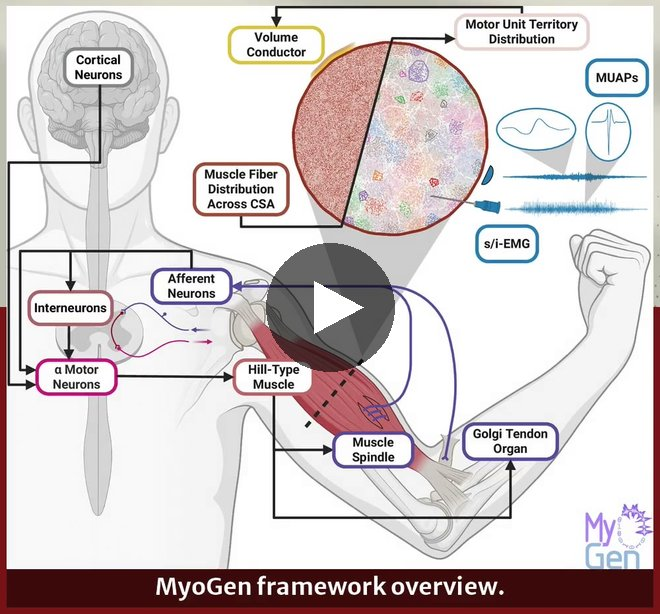

### Biophysical simulation from neural drive to EMG

[](https://www.nature.com/articles/s41467-026-79273-3)
[](https://pypi.org/project/myogen/)
[](https://github.com/NsquaredLab/MyoGen/blob/main/LICENSE.md)

[Install](#quick-start) · [Docs](https://nsquaredlab.github.io/MyoGen/) · [Examples](https://nsquaredlab.github.io/MyoGen/auto_examples/01_basic/) · [Cite](#how-to-cite)

<br clear="left">

## Overview

<a href="https://simpetru.com/img/myogen-summary.mp4"></a>

MyoGen simulates the neuromuscular pathway end to end: descending neural drive, spinal motor neurons, muscle activation and force, and the surface and intramuscular EMG they produce at the electrodes.

Every motor unit, spike time and fiber location stays accessible, so decomposition and decoding algorithms can be tested against signals whose ground truth is known.

- **Biophysical motor neurons.** NEURON models with validated calcium dynamics and membrane properties.
- **Vectorized and parallel.** NumPy and Numba on all CPU cores, optional GPU convolutions.
- **Reproducible.** Deterministic seeds and standard Neo Block outputs.
- **NWB export.** Share simulations through [Neurodata Without Borders](https://www.nwb.org/) and DANDI.

<br clear="right">

## Quick start

Needs Python 3.12+ and [uv](https://docs.astral.sh/uv/).

```bash
uv init my_emg_project
cd my_emg_project
uv add myogen
```

Or `pip install myogen`.

<details>
<summary><b>Windows prerequisites</b></summary>

1. [Visual C++ Build Tools](https://visualstudio.microsoft.com/visual-cpp-build-tools/) with MSVC Build Tools for x64/x86 (latest), MSVC v143 (VS 2022 C++ x64/x86 build tools), the Windows 11 SDK (latest) and C++ core desktop features.
2. [NEURON 8.2.7](https://github.com/neuronsimulator/nrn/releases/download/8.2.7/nrn-8.2.7.w64-mingw-py-39-310-311-312-313-setup.exe): run the installer, choose "Add to PATH", then restart the terminal.

</details>

<details>
<summary><b>Linux and macOS prerequisites</b></summary>

```bash
sudo apt install libopenmpi-dev   # Ubuntu, Debian
sudo dnf install openmpi-devel    # Fedora
brew install open-mpi             # macOS
```

</details>

<details>
<summary><b>From source</b></summary>

```bash
git clone https://github.com/NsquaredLab/MyoGen.git
cd MyoGen
uv sync
uv run poe setup_myogen
```

</details>

<details>
<summary><b>GPU acceleration</b></summary>

5 to 10 times faster convolutions on an NVIDIA GPU: `uv add cupy-cuda12x`

</details>

## Documentation

- [User guide](https://nsquaredlab.github.io/MyoGen/neo-blocks/): working with simulation outputs
- [API reference](https://nsquaredlab.github.io/MyoGen/api/)
- [Examples](https://nsquaredlab.github.io/MyoGen/auto_examples/01_basic/): step by step from recruitment to EMG

## How to cite

If you use MyoGen, please cite:

```bibtex
@article{simpetru_molinari_2026_myogen,
  title   = {{MyoGen}: unified biophysical modeling of human neuromotor activity and resulting signals},
  author  = {S{\^i}mpetru, Raul C. and Molinari, Ricardo G. and Rohlf, Devon R. and
             Batichotti, Rebeka L. and Watanabe, Renato N. and
             Elias, Leonardo A. and Del Vecchio, Alessandro},
  journal = {Nature Communications},
  volume  = {17},
  pages   = {11532},
  year    = {2026},
  doi     = {10.1038/s41467-026-79273-3},
  url     = {https://www.nature.com/articles/s41467-026-79273-3}
}
```

## Contributing

Contributions welcome! See [issues](https://github.com/NsquaredLab/MyoGen/issues) if you want to add a feature or fix a bug.

## Contributors

MyoGen is authored by **Raul C. Sîmpetru** and **Ricardo G. Molinari**. It is a joint project of the [Nsquared Lab](https://nsquared.tf.fau.de/) (Neuromuscular Physiology and Neural Interfacing Laboratory) at FAU Erlangen-Nürnberg, the [NER Lab](https://www.ceb.unicamp.br/pesquisa/laboratorios/laboratorio-de-pesquisa-em-neuroengenharia/) (Neural Engineering Research Laboratory) at the University of Campinas, and the [BMClab](https://bmclab.pesquisa.ufabc.edu.br/) (Biomechanics and Motor Control Laboratory) at the Federal University of ABC.

Thanks goes to these wonderful people ([emoji key](https://allcontributors.org/en/reference/emoji-key/)):

<!-- ALL-CONTRIBUTORS-BADGE:START - Do not remove or modify this section -->
[](#contributors)
<!-- ALL-CONTRIBUTORS-BADGE:END -->

<!-- ALL-CONTRIBUTORS-LIST:START - Do not remove or modify this section -->
<!-- prettier-ignore-start -->
<!-- markdownlint-disable -->
<table>
  <tbody>
    <tr>
      <td align="center" valign="top" width="14.28%"><a href="https://github.com/RaulSimpetru"><br /><sub><b>Raul C. Sîmpetru</b></sub></a><br /><a href="https://github.com/NsquaredLab/MyoGen/commits?author=RaulSimpetru" title="Code">💻</a> <a href="#ideas-RaulSimpetru" title="Ideas, Planning, & Feedback">🤔</a> <a href="#maintenance-RaulSimpetru" title="Maintenance">🚧</a> <a href="#projectManagement-RaulSimpetru" title="Project Management">📆</a> <a href="#research-RaulSimpetru" title="Research">🔬</a></td>
      <td align="center" valign="top" width="14.28%"><a href="https://github.com/molinaris"><br /><sub><b>Ricardo G. Molinari</b></sub></a><br /><a href="#ideas-molinaris" title="Ideas, Planning, & Feedback">🤔</a> <a href="#maintenance-molinaris" title="Maintenance">🚧</a> <a href="#research-molinaris" title="Research">🔬</a></td>
      <td align="center" valign="top" width="14.28%"><a href="https://github.com/DRohlf"><br /><sub><b>Devon R. Rohlf</b></sub></a><br /><a href="https://github.com/NsquaredLab/MyoGen/commits?author=DRohlf" title="Code">💻</a> <a href="#maintenance-DRohlf" title="Maintenance">🚧</a> <a href="#research-DRohlf" title="Research">🔬</a></td>
      <td align="center" valign="top" width="14.28%"><a href="https://github.com/rnwatanabe"><br /><sub><b>Renato N. Watanabe</b></sub></a><br /><a href="https://github.com/NsquaredLab/MyoGen/commits?author=rnwatanabe" title="Code">💻</a> <a href="#ideas-rnwatanabe" title="Ideas, Planning, & Feedback">🤔</a> <a href="#mentoring-rnwatanabe" title="Mentoring">🧑‍🏫</a> <a href="#research-rnwatanabe" title="Research">🔬</a></td>
      <td align="center" valign="top" width="14.28%"><a href="https://github.com/alecsdelvecchio"><br /><sub><b>Alessandro Del Vecchio</b></sub></a><br /><a href="#ideas-alecsdelvecchio" title="Ideas, Planning, & Feedback">🤔</a> <a href="#mentoring-alecsdelvecchio" title="Mentoring">🧑‍🏫</a> <a href="#research-alecsdelvecchio" title="Research">🔬</a></td>
      <td align="center" valign="top" width="14.28%"><a href="https://github.com/leoelias-unicamp"><br /><sub><b>Leonardo A. Elias</b></sub></a><br /><a href="#ideas-leoelias-unicamp" title="Ideas, Planning, & Feedback">🤔</a> <a href="#mentoring-leoelias-unicamp" title="Mentoring">🧑‍🏫</a> <a href="#research-leoelias-unicamp" title="Research">🔬</a></td>
      <td align="center" valign="top" width="14.28%"><a href="https://github.com/joaohbbittar"><br /><sub><b>João Bittar</b></sub></a><br /><a href="https://github.com/NsquaredLab/MyoGen/issues?q=author%3Ajoaohbbittar" title="Bug reports">🐛</a> <a href="#ideas-joaohbbittar" title="Ideas, Planning, & Feedback">🤔</a></td>
    </tr>
    <tr>
      <td align="center" valign="top" width="14.28%"><a href="https://github.com/veylantis"><br /><sub><b>BraveUnicorn</b></sub></a><br /><a href="https://github.com/NsquaredLab/MyoGen/commits?author=veylantis" title="Code">💻</a></td>
    </tr>
  </tbody>
  <tfoot>
    <tr>
      <td align="center" size="13px" colspan="7">
        
          <a href="https://all-contributors.js.org/docs/en/bot/usage">Add your contributions</a>
        </img>
      </td>
    </tr>
  </tfoot>
</table>

<!-- markdownlint-restore -->
<!-- prettier-ignore-end -->

<!-- ALL-CONTRIBUTORS-LIST:END -->

This project follows the [all-contributors](https://github.com/all-contributors/all-contributors) specification. Contributions of any kind welcome!

## License

MyoGen is AGPL licensed. See [LICENSE](https://github.com/NsquaredLab/MyoGen/blob/main/LICENSE.md) for details.
