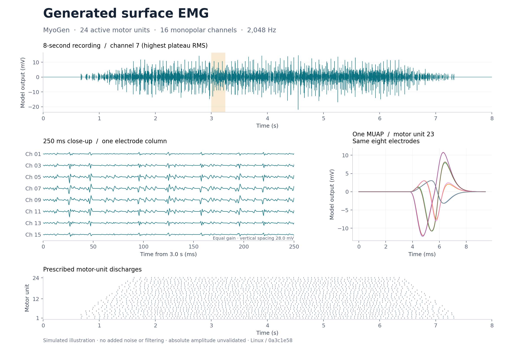
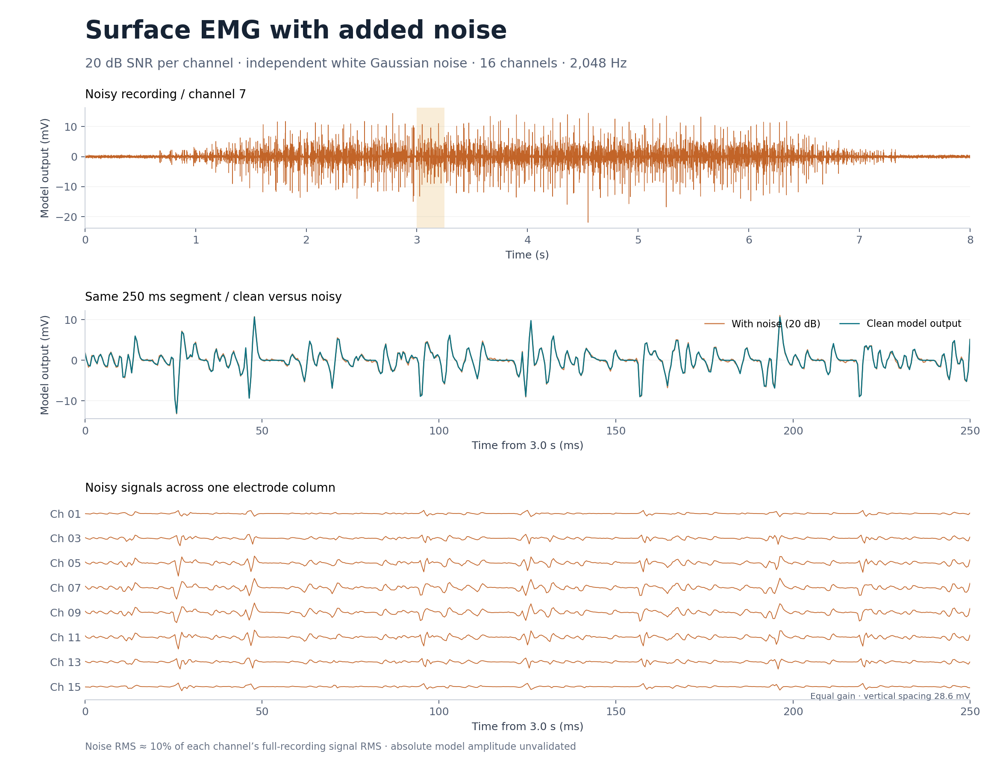

# Linux validation and surface-EMG illustration

Completed 2026-10-19 against `0a3c1e5861cfb4380efcb2a1b00ab027158dacff`,
following Devon Rohlf's original CPU optimization and review fixes. His commits
are retained unchanged. The added cache-lifetime correction is by Raul C. Sîmpetru.

## Cache lifetime

Session finalizers previously retained memory controllers through bound lease
callbacks. Controllers could retain cache-eviction callbacks and cached arrays,
keeping discarded simulators' data alive. Session exit now closes outstanding
leases, detaches its finalizers and clears tracking/eviction references in a
`finally` block. Caches on live simulators remain usable.

Seven added regression cases cover normal/exceptional exit, failed entry,
late probe failure, temporary-array accounting, and iEMG/sEMG cache reuse and
collection. Six failed before the fix; all seven pass with it.

## Full automated suite

**271 passed, zero failures, zero skips, 80 warnings in 123.85 seconds.**
No tests were deselected, including the slow clinical synthesis test.
GPU, Elephant comparison and experimental-data tests all ran. The experimental
tests used the existing 142 input files; these files are not included in Git.

| Setting or measurement | Value |
|---|---|
| Host | Linux x86-64, Ryzen 9 7950X, approximately 91 GiB physical RAM |
| GPU | NVIDIA RTX 4090, driver 595.71.05 |
| Interpreter | Python 3.12.8 |
| Numerical packages | NumPy 2.4.6, SciPy 1.17.1, Numba 0.65.1, NEURON 8.2.7 |
| Test/optional packages | pytest 9.0.3, Elephant 1.2.1, CuPy CUDA 13 wheel 14.2.0 |
| CPU affinity | 0, 2, 4, 6 |
| Cgroup memory / swap limit | 16 GiB / zero |
| Observed cgroup memory peak | 1,441,955,840 bytes (1.34 GiB) |
| Memory limit / OOM / OOM-kill events | All zero |

CuPy's CUDA 13 wheel was installed separately in the isolated test environment
for this workstation. This does not change the project's CUDA 12 optional extra.
Warnings include deprecations, binning diagnostics, conductor edge arithmetic
and complex-to-real casts; this was not a warning-free run.

After dependency/mechanism setup and making the experimental fixtures available,
the suite command is:

```sh
mkdir -p artifacts
export CUDA_PATH=/usr/local/cuda-13.0
export LD_LIBRARY_PATH=/usr/local/cuda-13.0/targets/x86_64-linux/lib
export OMP_NUM_THREADS=1 OPENBLAS_NUM_THREADS=1 MKL_NUM_THREADS=1 NUMBA_NUM_THREADS=4
systemd-run --user --scope \
  -p MemoryMax=16G -p MemorySwapMax=0 -p AllowedCPUs=0,2,4,6 \
  taskset -c 0,2,4,6 .venv/bin/python -m pytest tests/ -v -rs \
  --junitxml=artifacts/linux-validation.xml
```

The runner verified the cgroup limits, affinity, source hashes and fixture count
before starting pytest. The [compact result manifest](linux-validation.json)
records the measurements and hashes of the retained full log and JUnit output.

## Additional runtime checks

- Sixty repetitions of the external-consumer pressure/recovery integration test
  passed in 63.83 seconds. Each repetition used a real 64 MiB consumer with a
  synthetic 16 GiB memory probe. This checks admission and recovery contracts.
- A separate lifecycle stress run used 240 simulator instances and 960 calls:
  720 successful calls and 240 expected budget rejections. Repeated recordings
  were bitwise identical, all discarded caches/controllers were collected, and
  post-collection RSS remained approximately 254.3–254.6 MB.

A cgroup cap on a larger host is **not physical four-core/16-GiB acceptance**.
The production physical-memory probe sees host RAM, not the cgroup's limit.
The repeated synthetic pressure checks do not replace a full-population pressure
benchmark. Exhaustive corrected-sEMG waveform comparisons and full-pipeline
timings still need the original frozen 58,755-fiber inputs and references.

## Clean and noisy sEMG

The [reproduction scripts](../../benchmarks/semg_demo/README.md) generate a separate
illustration: 100 modeled motor units, the first 24 active (935 simulated fibers),
16 monopolar channels, 2,048 Hz and eight seconds of prescribed firing. These are
new illustrative inputs, not Devon's frozen benchmark cohort.



Independent white Gaussian noise was added at 20 dB SNR per channel, measured
against each clean channel's full-recording mean-square value. The measured SNR
ranged from 19.919 to 20.047 dB. Original clean arrays were preserved.
The committed generation and noise scripts were rerun on Linux and reproduced
both sets of saved arrays bit-for-bit. The plot-only command also completed.



The displayed clean channel reaches approximately 36.5 mV peak-to-peak.
Its absolute amplitude remains unvalidated; no scaling was applied to make the
figure appear physiologically calibrated. Noise addition does not address this
limit. Full generated arrays, experimental data, logs and compiled mechanisms
remain outside Git; only the illustrative figures and reproduction code are added.
